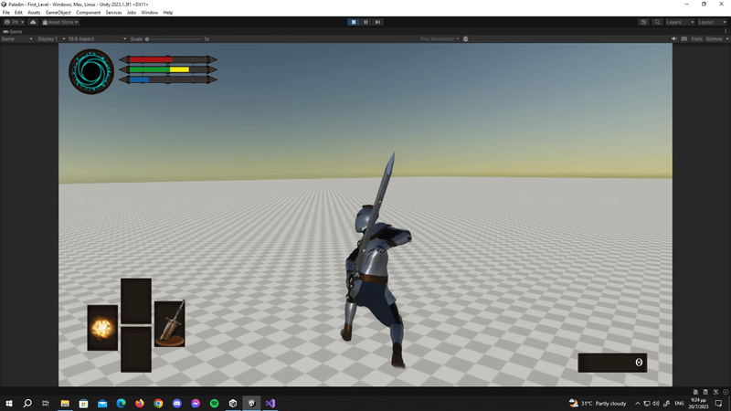

⚔️ **Souls-like Stamina System**

A stamina-based combat system inspired by the mechanics of Souls-like games.

🎮 **Features**

- Stamina Management: A stamina bar that decreases when performing stamina-consuming actions.

- Action-Based Consumption: Stamina is consumed when attacking or sprinting.

- Stamina Regeneration: Stamina automatically regenerates when the player stops performing stamina-consuming actions.

⚙️ **How It Works**

The stamina system is designed around a simple gameplay loop:

- The player performs an action.

- The system checks whether enough stamina is available.

- Stamina is consumed based on the performed action.

- Stamina regeneration begins when the player stops consuming stamina.

🛠️ **Technologies**

- Unity

- C#

